# AI Image Bridge 0.4.0

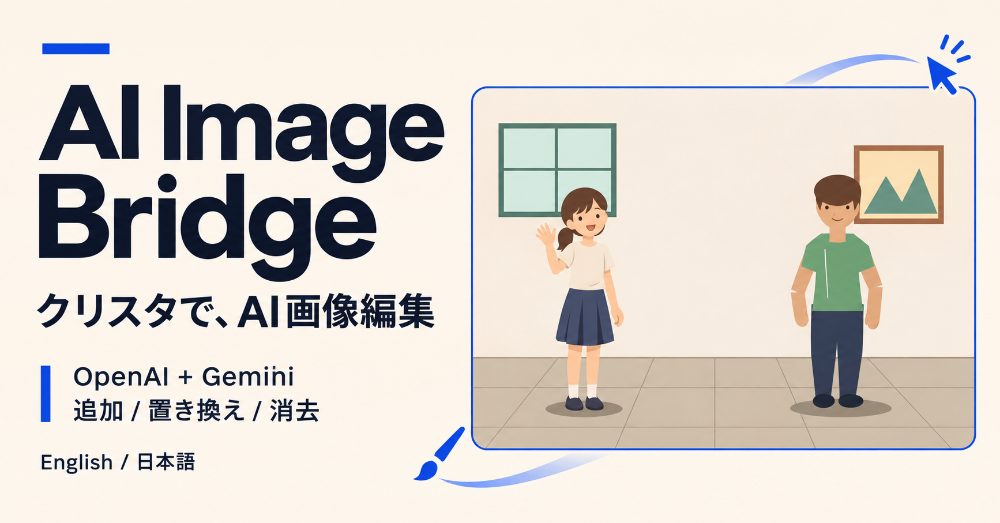

Edit the current CLIP STUDIO PAINT raster layer with OpenAI or Gemini image APIs. Add a person, replace an object, or remove something and reconstruct the background, using a short instruction and an optional rough position hint. / CLIP STUDIO PAINTの現在のラスターレイヤーを、OpenAIまたはGeminiの画像APIで編集します。短い文章と必要に応じた位置の目安で、人物の追加、小物の置き換え、対象の消去と背景補完ができます。

No local GPU model, Python, or ComfyUI is required. Bring your own API key with paid image API access. / ローカルGPUモデル、Python、ComfyUIは不要です。画像APIを利用できるご自身のAPIキーと、API利用料金が必要です。

Click an image button to open the download or guide. / 画像ボタンをクリックすると、ダウンロードや案内を開きます。

[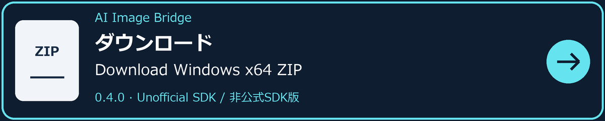](https://github.com/FURUYAN1234/ai-image-bridge/releases/download/v0.4.0/AI-Image-Bridge-0.4.0-Windows-x64.zip)

[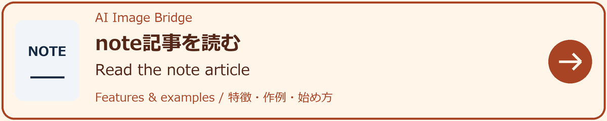](https://note.com/happy_duck780/n/n6747a089fce7)

## Overview / できること

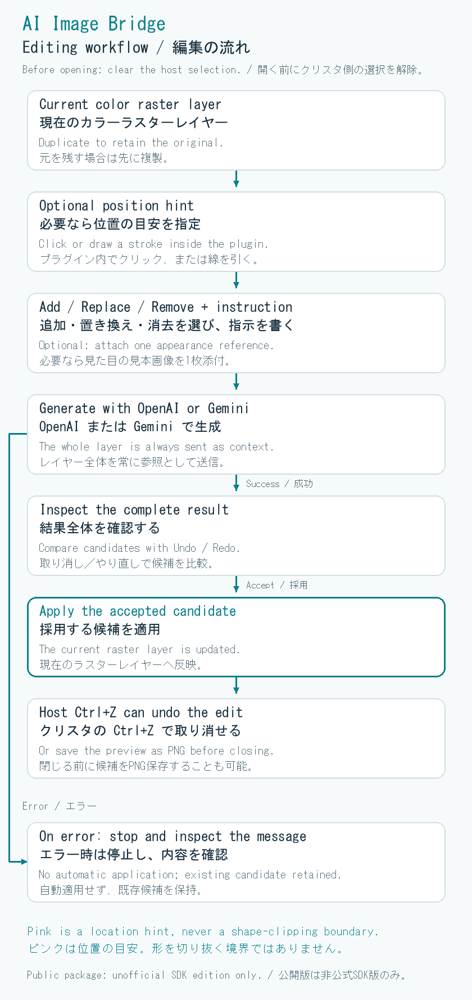

<details>
<summary>Maintainable Mermaid source / 更新用Mermaid</summary>

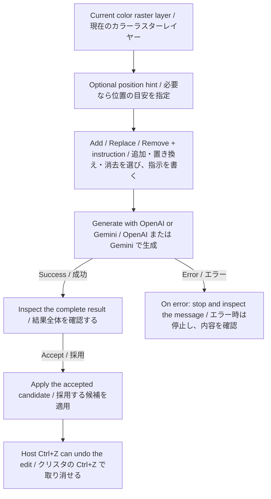

</details>

| Feature / 機能 | Behavior / 動作 |
| --- | --- |
| Add / 追加 | Add the requested subject while asking the model to preserve existing subjects. / 既存の人物などを保つよう指示して、対象を追加します。 |
| Replace / 置き換え | Replace the indicated subject without retaining a duplicate. / 指定した対象を、重複させず別の対象に置き換えます。 |
| Remove / 消去 | Remove the subject and its shadow and reconstruct the surrounding scene. / 対象と影を消し、周囲の背景を補完します。 |
| Rough position / 位置の目安 | Click or draw an open stroke on the source preview. The hint need not trace a silhouette. / 元画像をクリックするか線でなぞります。輪郭を正確に囲む必要はありません。 |
| Reference image / 見本画像 | Attach one image for appearance, clothes, props, or style. / 外見、服装、小物、画風の見本を1枚添えられます。 |
| Candidate editing / 候補からの編集 | Continue from the shown result or restart from the original layer. / 表示中の候補から続けるか、元レイヤーから編集できます。 |
| Undo and Redo / 取り消しとやり直し | Browse retained candidates locally, including the original image, without another API call. / 元画像を含め、保持した候補を追加のAPI呼び出しなしで戻せます。 |
| Japanese and English / 日本語と英語 | Switch the plugin interface language. Host compatibility is tested separately. / プラグイン画面の言語を切り替えます。ホスト側の対応状況は別に確認します。 |

The model receives the whole layer. The pink hint indicates an approximate position; it is not a crop or a boundary that forces a body into a narrow shape. Review the whole result because the background and other subjects may also change. / AIにはレイヤー全体を送ります。ピンクの表示は位置の目安で、切り抜き範囲や身体を押し込める枠ではありません。指定外の背景や人物が変わる場合もあるため、結果全体を確認してください。

## Download and editions / 入手先と版

| Edition / 版 | Download or route / 入手先と経路 | Status / 状況 |
| --- | --- | --- |
| Unofficial SDK build / 非公式SDK版 | [Download ZIP / ZIPを取得](https://github.com/FURUYAN1234/ai-image-bridge/releases/download/v0.4.0/AI-Image-Bridge-0.4.0-Windows-x64.zip) · [Release / リリース](https://github.com/FURUYAN1234/ai-image-bridge/releases/tag/v0.4.0) · [Source / ソース](https://github.com/FURUYAN1234/ai-image-bridge) | Public distribution edition / 一般配布用の非公式SDK版 |
| CELSYS official SDK build / CELSYS公式SDK版 | Submission to CELSYS for review and the designated distribution route. / CELSYSへの審査申請と指定された配布経路。 | Submitted to CELSYS on 2026-11-14; awaiting review and distribution guidance. / 2026年11月14日にCELSYSへ申請済み。審査と配布条件の回答待ちです。 |

The editions share editing and API features. The public unofficial build uses the independently published SDPlugin interface, not CELSYS SDK files. Do not distribute the official SDK build through the unofficial repository. / 編集機能とAPI処理は共通です。公開用の非公式SDK版は、別途公開されているSDPluginインターフェースを使用し、CELSYSのSDKファイルを含めません。公式SDK版を非公式版のリポジトリへ混ぜて配布しないでください。

## Requirements / 必要な環境

| Item / 項目 | Requirement or verified scope / 条件と確認範囲 |
| --- | --- |
| Host / ホスト | Windows x64 and CLIP STUDIO PAINT EX; prior editing verification used EX 4.1.4. / Windows x64とCLIP STUDIO PAINT EX。従来の編集検証はEX 4.1.4で実施。 |
| Other editions / その他の版 | PRO, other operating systems, and English-language host plugin loading are unverified. / PRO版、他OS、英語版ホストでのプラグイン読み込みは未確認。 |
| API account / APIアカウント | OpenAI or Gemini API key with access to image models and sufficient API balance or billing. / 画像モデルを利用でき、残高または課金設定のあるOpenAIまたはGemini APIキー。 |
| Network / 通信 | HTTPS access to the selected provider. / 選択した提供元へのHTTPS接続。 |
| Layer / レイヤー | Current color raster layer; duplicate it first to retain the original. / 現在のカラーラスターレイヤー。元を残す場合は先に複製。 |

A ChatGPT subscription does not include OpenAI API usage. API requests can incur charges even if the result is not applied. / ChatGPTの月額契約とOpenAI API料金は別です。結果を適用しない場合も、API処理には料金がかかります。

## Install, update, and remove / 導入・更新・削除


1. Save open work and exit CLIP STUDIO PAINT. / 作業を保存し、CLIP STUDIO PAINTを終了します。
2. Download `AI-Image-Bridge-0.4.0-Windows-x64.zip` from the [v0.4.0 release](https://github.com/FURUYAN1234/ai-image-bridge/releases/tag/v0.4.0) and extract the entire ZIP into a new folder. / [v0.4.0のRelease](https://github.com/FURUYAN1234/ai-image-bridge/releases/tag/v0.4.0)から`AI-Image-Bridge-0.4.0-Windows-x64.zip`を取得し、新しいフォルダーへ全体を展開します。
3. Double-click `Install.cmd` and follow its prompts. Keep the bundled license files with the plugin. / `Install.cmd`を実行して案内に従います。同梱のライセンスファイルもプラグインと一緒に配置してください。
4. Start CLIP STUDIO PAINT and open `Filter → AI Image Bridge (Unofficial SDK) → AI image editor...`. / CLIP STUDIO PAINTを起動し、`フィルター → AI Image Bridge (Unofficial SDK) → AI画像編集...`を開きます。
5. Enter an API key and use the model-retrieval button. Confirm that image models appear before generating. / APIキーを入力してモデル取得ボタンを押し、画像モデルが表示されてから生成します。

For updates, save and exit the host before replacing files through the installer. Keys held by the previous process are lost on restart. To remove the plugin, exit the host and run the bundled `Uninstall.cmd`; backups and user files are retained. / 更新時も保存してホストを終了し、インストーラーでファイルを置き換えます。再起動で前回のキーは失われます。削除する場合はホストを終了し、同梱の`Uninstall.cmd`を実行します。バックアップと利用者のファイルは保持します。

## First edit / 最初の編集

1. Duplicate the layer if needed. Clear any selection in CLIP STUDIO PAINT before opening the plugin. / 必要ならレイヤーを複製し、クリスタ側の選択範囲を解除してから開きます。
2. Choose OpenAI or Gemini, enter its key, and retrieve models. / OpenAIまたはGeminiを選び、その提供元のキーを入力してモデルを取得します。
3. Choose Add, Replace, or Remove. Click or draw over the approximate target in the left preview, or identify it only in text. / 追加、置き換え、消去を選びます。左の元画像で位置をクリック・なぞり書きするか、文章だけで対象を指定します。
4. Write the instruction and generate. Placeholder examples are not sent as instructions. / 指示を書いて生成します。薄い例文は指示として送信されません。
5. Inspect the right preview, then apply or save PNG. After applying, the host's Ctrl+Z restores the previous layer. / 右の候補を確認し、適用またはPNG保存します。適用後はクリスタのCtrl+Zで戻せます。

| Intent / 内容 | Example / 指示例 |
| --- | --- |
| Add / 追加 | Add a girl standing and waving on the left. Keep the man and the room. / 左に立って手を振る女の子を追加して。男性と部屋はそのまま。 |
| Replace / 置き換え | Replace the girl on the left with a large brown dog sitting naturally. Keep the man. / 左の女の子を、自然に座る大きめの茶色い犬に置き換えて。男性はそのまま。 |
| Remove / 消去 | Remove the man on the right and his shadow. Reconstruct the wall and floor. Keep the girl. / 右の男性と影を消して壁と床を補完して。女の子は残して。 |

## Controls / 操作の詳細

| Control / 操作 | Meaning / 内容 |
| --- | --- |
| Reference image / 見本画像を追加 | One optional appearance reference; confirm its thumbnail and filename, and clear it when no longer needed. / 任意の外見見本1枚。サムネイルと名前で確認し、不要なら解除します。 |
| Clear position / 位置指定を解除 | Remove the pink hint. A new click or stroke replaces the previous hint. / ピンクの目安を消します。新たなクリックや線でも前の指定を置き換えます。 |
| Original / Candidate / 元レイヤー／候補 | Choose the input for the next request. / 次の生成の入力を選びます。 |
| Undo / Redo / 取り消し／やり直し | Keep up to the latest eight candidates within an approximately 256 MB budget. Generating after Undo replaces the forward history. / 最新8候補、合計約256MBを目安に保持。戻した位置で新規生成すると、その先の履歴を置き換えます。 |
| Save PNG / PNG保存 | Export the shown candidate separately from applying it to the canvas. / 表示中の候補を、キャンバス適用とは別に保存します。 |
| Close without applying / 適用せず閉じる | Leave the canvas unchanged; ordinary candidate history is discarded. Save PNG to retain it. / キャンバスを変更せず閉じ、通常の候補履歴は破棄します。残す場合はPNG保存します。 |
| Cancel communication / 通信を中止 | Stop waiting locally. A submitted server request may continue and incur charges. / ローカルの通信待ちを停止します。送信済みの処理はサーバー側で続き、課金される場合があります。 |

## Models and request settings / モデルと生成設定

OpenAI initially selects the available GPT Image 2.6 Sunburst model, requesting `quality=max` and `complexity=high`. If unavailable, choose another supported model from the retrieved list. Gemini initially selects the newer retrieved image model, requesting 4K where supported; older 2.5 image models use their model-defined resolution. / OpenAIは利用可能なGPT Image 2.6 Sunburstを初期選択し、`quality=max`と`complexity=high`を指定します。利用できない場合は取得した対応モデルから選択します。Geminiは取得した画像モデルの新しい版を初期選択し、対応モデルでは4K、旧2.5画像モデルではモデル規定の解像度を使います。

Only an explicit HTTP 400 rejection of an unsupported quality or complexity setting triggers compatibility fallback, at most once per setting: quality to `high`, complexity to the model default. The used settings remain visible. Authentication, balance, rate-limit, safety, or general errors do not trigger lower-quality retries. / qualityまたはcomplexityの未対応がHTTP 400で明確に返された場合だけ、各設定1回まで互換対応を行います。qualityは`high`、complexityはモデル既定へ変更し、使用設定を表示します。認証、残高、混雑、安全性拒否、一般エラーで画質を下げて再生成することはありません。

## Layer limits and existing selections / レイヤーと既存の選択範囲

Only the current raster layer is edited; layers are not automatically merged and new layers are not created. A selected layer mask is rejected. Transparency lock preserves existing alpha. / 対象は現在のラスターレイヤーだけです。レイヤーの自動合成や新規作成は行いません。レイヤーマスク選択中は処理を拒否し、透明度ロック中は既存の透明度を保持します。

An existing host selection restricts filter writes. In that case only, hold the candidate with the deferred-apply control, close, press Ctrl+D, and reopen on the same unchanged layer. The candidate is restored only when source pixels, dimensions, and coordinates match; this does not regenerate or charge again. It disappears when the host exits. The normal workflow uses the plugin's own hint and applies directly. / クリスタ側に選択範囲がある場合は、フィルターの書き込み範囲が制限されます。その場合だけ選択解除後に適用する操作で候補を保持し、閉じてCtrl+Dで選択解除し、変更していない同じレイヤーで開き直します。元画像の画素、寸法、座標が一致した場合だけ復元し、再生成や追加課金はありません。ホスト終了で候補は消えます。通常はプラグイン内の位置指定を使い、そのまま適用してください。

Input limits are 33,554,432 pixels and 16,384 pixels per side. Reference files and responses are limited to 64 MB each; outgoing requests to 128 MB. Provider limits also apply. / 入力上限は33,554,432画素、各辺16,384pxです。見本画像ファイルと応答は各64MB、送信は128MBまで。API側の制限も適用されます。

## Keys, data, and diagnostics / キー・送信データ・診断記録

Keys are held separately per provider in host-process memory and are never saved to disk by the plugin. Switching providers or reopening the dialog retains them until the host exits. Editing a recognized key enables model retrieval again; clearing a key affects only the selected provider after confirmation. / キーは提供元ごとにホストプロセスのメモリで保持し、プラグインはディスクへ保存しません。接続先の切替や画面の開き直しでは保持し、ホスト終了で破棄します。認識済みキーを書き換えると再取得でき、キー消去は確認後に現在の提供元だけへ適用します。

Instructions, the layer image, the position guide, and an attached reference are sent to the selected provider. Connections use `api.openai.com` or `generativelanguage.googleapis.com`. Consider the provider's data terms before submitting unpublished or sensitive artwork. / 指示、レイヤー画像、位置の目安、添付した見本を選択した提供元へ送ります。接続先は`api.openai.com`または`generativelanguage.googleapis.com`です。未公開作品などを送る前に、提供元のデータ取扱条件を確認してください。

`diagnostics.jsonl` records run IDs, models, HTTP status, elapsed time, dimensions, settings, and usage. It does not record keys, prompts, images, or response bodies. Memory-only storage does not protect a compromised running computer. / `diagnostics.jsonl`には実行ID、モデル、HTTP状態、時間、寸法、設定、使用量を記録し、キー、指示文、画像、応答本文は記録しません。メモリ保持は、実行中のPCそのものが侵害された場合の保護を保証しません。

## 0.4.0 verified examples / 0.4.0の実動作確認

| Build and request / ビルドと処理 | Settings / 設定 | Elapsed / 所要時間 | Result / 結果 |
| --- | --- | --- | --- |
| Official SDK review build, add a cat / 公式SDK審査用版で猫を追加 | OpenAI Sunburst, max/high | 92.42 s / 秒 | Natural cat addition; exact RGBA Apply and host Undo. / 自然な猫の追加、適用とホストUndoの全RGBA一致。 |
| Public unofficial SDK build, replace cat with rabbit / 公開用非公式SDK版で猫をウサギへ置換 | Gemini Nano Banana 2.1, 4K | 29.41 s / 秒 | One white rabbit, people and background retained; exact RGBA Apply and host Undo. / 白いウサギ1匹へ置換し、人物と背景を保持。適用とホストUndoの全RGBA一致。 |

Both actual API requests completed with HTTP 200 and no compatibility fallback. The unofficial build also retained the recognized provider, model, English instruction, and candidate when switching the interface back to Japanese. Times include the normal encode/network/generation/decode/UI path and are examples, not speed guarantees. / 両方とも実APIでHTTP 200、互換フォールバックなしで完了しました。非公式版では日本語へ切り替えたあとも、接続認識、モデル、英語の指示、候補が保持されることを確認しました。時間は通常経路のエンコード、通信、生成、デコード、画面受信を含む実測例で、速度保証ではありません。

| OpenAI addition / OpenAIで追加 | Gemini replacement / Geminiで置き換え |
| --- | --- |
| 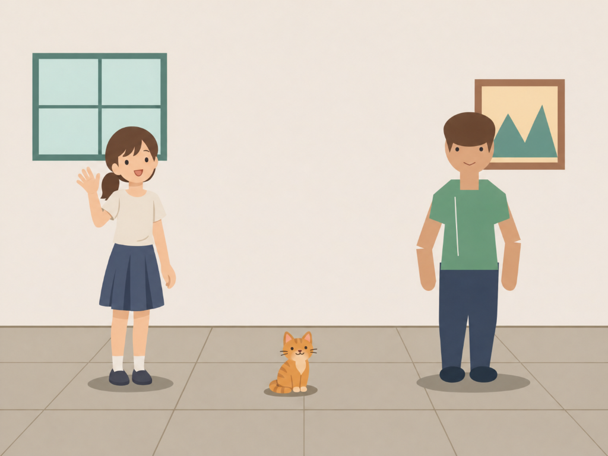 | 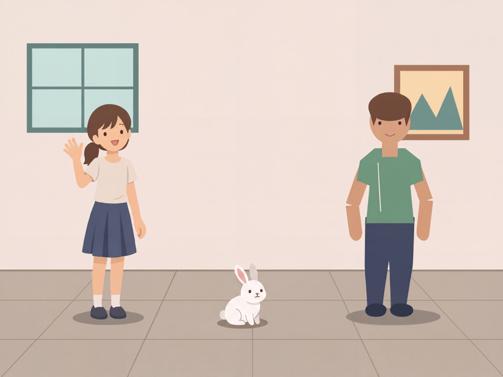 |

The official-build example is review evidence, not a downloadable official SDK edition or CELSYS approval. / 公式版の作例は審査用ビルドの検証資料であり、公式SDK版をダウンロードできることやCELSYSの承認を意味しません。

## Earlier verification / 従来版の検証範囲

The following are earlier 0.3.x editing-path results, separate from the 0.4.0 host and API verification above. / 以下は従来の0.3.x編集経路の結果であり、上記0.4.0のホスト・実API検証とは別の記録です。

| Actual request / 実リクエスト | Elapsed / 所要時間 | Observed result / 確認結果 |
| --- | --- | --- |
| OpenAI Sunburst, max/high, Add / 追加 | 84.56 s / 秒 | Complete waving girl added; existing man retained. / 手を振る女の子を追加し、既存の男性を保持。 |
| Gemini Nano Banana 2.1, 4K, Add / 追加 | 41.42 s / 秒 | Girl added with natural proportions. / 自然な体形で女の子を追加。 |
| Gemini Nano Banana 2.1, 4K, Replace / 置き換え | 26.82 s / 秒 | Girl replaced with one brown dog; man retained. / 女の子を1匹の茶色い犬へ置換し、男性を保持。 |
| OpenAI Sunburst, max/high, Remove / 消去 | 97.32 s / 秒 | Man and shadow removed; girl retained. / 男性と影を消去し、女の子を保持。 |

Times cover encoding, communication, generation, decoding, and UI receipt after Generate, without retries. They are examples, not speed guarantees. Earlier exact-pixel checks confirmed candidate application and host Undo; 0.3.1 had 98 core assertions. / 時間は生成操作後のエンコード、通信、生成、デコード、画面受信までを含み、再試行はありません。速度保証ではありません。従来の全画素比較では候補の適用とホストUndoを確認し、0.3.1のコア検査は98項目でした。

## Interface source and acknowledgments / インターフェースの参照元・謝辞

The unofficial SDK build uses the ABI interface declarations in `FilterPlugIn.h`, obtained from [ComfyUIPlugin by Hiiragi (potechitakusan)](https://github.com/potechitakusan/ComfyUIPlugin) at commit `37101fe5c023e3759e8e3158a706b85cda502cf2`. That interface originates from [AonekoSS/SDPlugin](https://github.com/AonekoSS/SDPlugin). Thank you to both projects for publishing this work. / 非公式SDK版は、柊さん（potechitakusan）の[ComfyUIPlugin](https://github.com/potechitakusan/ComfyUIPlugin)の上記コミットから取得した `FilterPlugIn.h` のABIインターフェース宣言を利用しています。その由来は[AonekoSS/SDPlugin](https://github.com/AonekoSS/SDPlugin)です。両プロジェクトの公開に感謝します。

The reused interface retains its Unlicense. AI Image Bridge's cloud API integration and editing UI are separate application code; this does not claim endorsement from the upstream authors. See [third-party notices](THIRD_PARTY_NOTICES.md) for provenance and bundled licenses. / 利用部分には元のUnlicenseを保持しています。AI Image BridgeのクラウドAPI接続と編集画面は別途実装したもので、参照元作者の承認・推奨を意味しません。出典と同梱ライセンスは[第三者ライセンス表記](THIRD_PARTY_NOTICES.md)をご覧ください。

## Licenses and generated images / ライセンスと生成画像

Original application code is licensed under MIT. The unofficial SDPlugin interface is Unlicense; nlohmann/json 3.12.0 is MIT. Preserve their notices. CELSYS official SDK files and binaries are excluded from the public unofficial package. / 独自アプリコードはMITライセンスです。非公式SDPluginインターフェースはUnlicense、nlohmann/json 3.12.0はMITです。各表記を保持してください。公開する非公式版にCELSYS公式SDKのファイルとバイナリーは含めません。

The software license does not license generated images. The author claims no rights in your outputs. Your use remains subject to API terms, applicable law, and third-party rights; this does not guarantee copyright protection or exclusive rights in every output. / ソフトウェアのライセンスは生成画像には適用しません。作者は利用者の生成物への権利を主張しません。API条件、適用法令、第三者の権利は引き続き適用され、すべての生成物に著作権や独占権が成立する保証ではありません。

This is an independent project and does not claim CELSYS approval, endorsement, or universal legal clearance. / 独立したプロジェクトであり、CELSYSの承認や推奨、あらゆる利用の適法性を表明するものではありません。

## PDF manuals / PDFマニュアル

[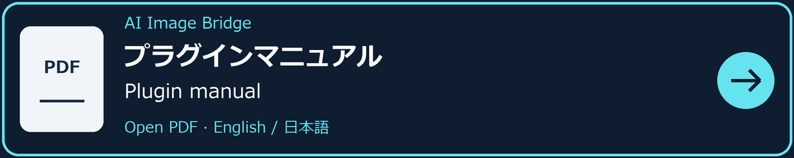](https://github.com/FURUYAN1234/ai-image-bridge/blob/main/docs/manuals/AI-Image-Bridge-Manual.pdf)

[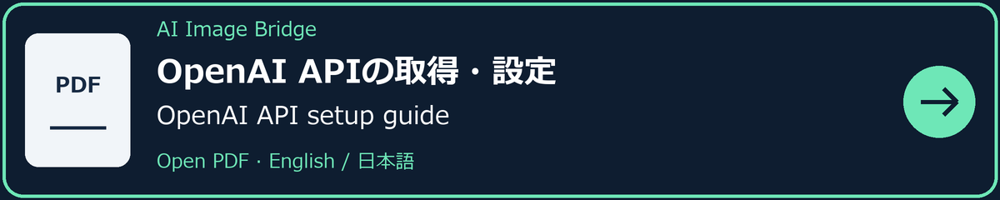](https://github.com/FURUYAN1234/ai-image-bridge/blob/main/docs/manuals/OpenAI-API-Setup.pdf)

[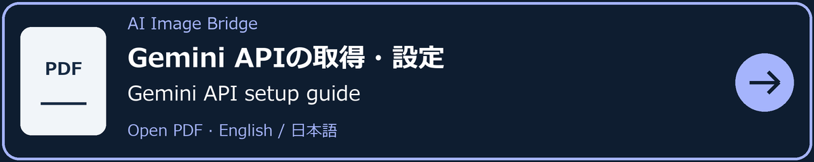](https://github.com/FURUYAN1234/ai-image-bridge/blob/main/docs/manuals/Gemini-API-Setup.pdf)

Use the top-right Manual button and choose one of the three manuals. The installed PDF opens in your default PDF viewer. / 右上のマニュアルボタンから3冊のいずれかを選ぶと、インストール済みPDFを既定のビューアーで開きます。

| Manual / マニュアル | File / ファイル |
| --- | --- |
| Plugin guide / プラグインの使い方 | [AI Image Bridge Manual](docs/manuals/AI-Image-Bridge-Manual.pdf) |
| OpenAI setup / OpenAI API準備 | [OpenAI API Setup](docs/manuals/OpenAI-API-Setup.pdf) |
| Gemini setup / Gemini API準備 | [Gemini API Setup](docs/manuals/Gemini-API-Setup.pdf) |

The ZIP's `manuals` folder is installed under the plugin folder. The installer backs up a previous CloudImage installation under `%LOCALAPPDATA%\AIImageBridge\backups`. The two SDK variants share the plugin identity and must not be installed together. Use the unofficial edition for the ordinary public ZIP workflow. / ZIPの`manuals`フォルダーもプラグイン内へ配置します。旧CloudImageは`%LOCALAPPDATA%\AIImageBridge\backups`へ退避します。SDKの異なる2版は同じプラグイン識別子を使うため、同時に導入できません。通常の公開ZIPでは非公式版を使います。

Gemini API terms require users to be at least 18, describe professional or business developer purposes rather than consumer use, and restrict availability by region. EEA, Switzerland, and UK API clients require Paid Services. Confirm your intended use before connecting. / Gemini API規約は18歳以上を条件とし、一般消費者用途ではなく業務・事業目的の開発者向け利用を定め、地域も制限しています。EEA、スイス、英国向けAPIクライアントには有料サービス条件があります。接続前にご自身の用途が条件に合うか確認してください。 [Terms / 規約](https://ai.google.dev/gemini-api/terms)

## Earlier editing examples / 従来版の編集例

Earlier accepted 0.3.x editing-path examples are shown below. / 以下は従来の0.3.x編集経路で採用した作例です。

| Before / 元画像 | Add with OpenAI / OpenAIで追加 |
| --- | --- |
| 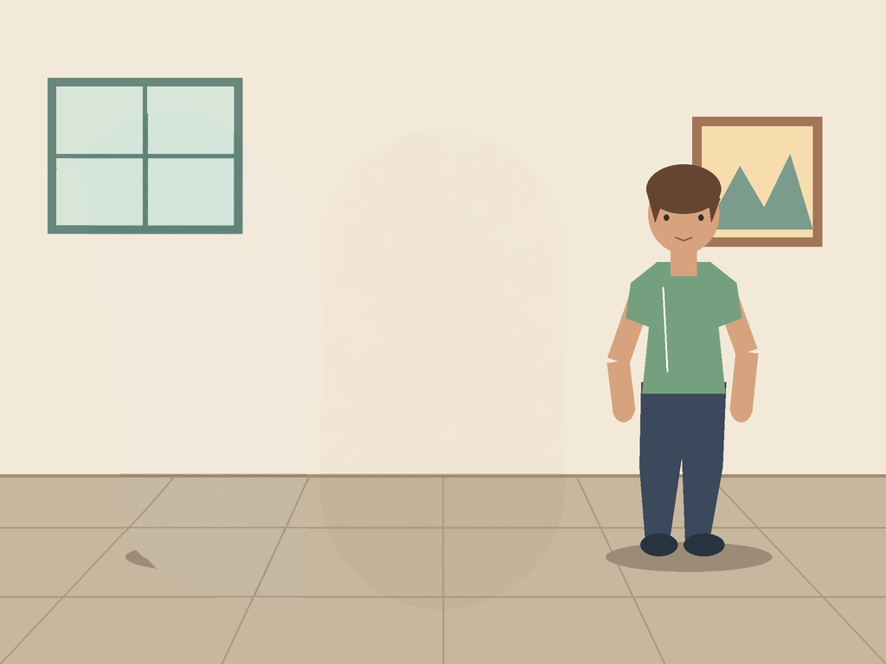 | 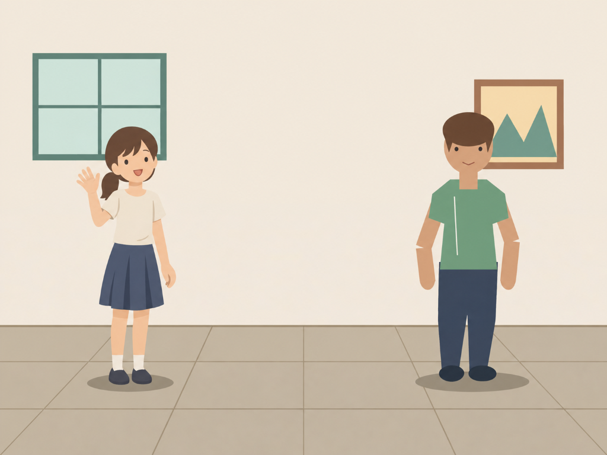 |

| Replace with Gemini / Geminiで置換 | Remove with OpenAI / OpenAIで消去 |
| --- | --- |
| 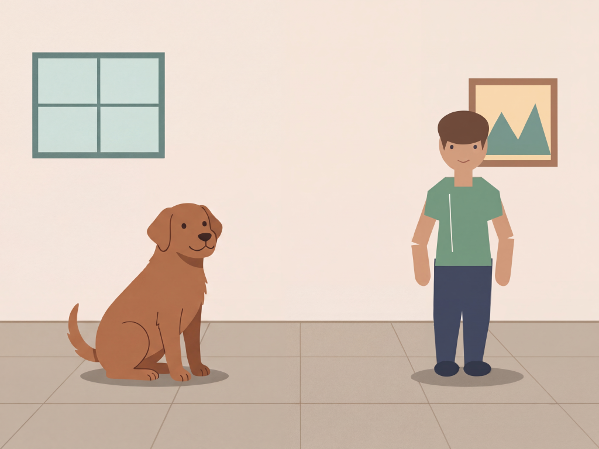 | 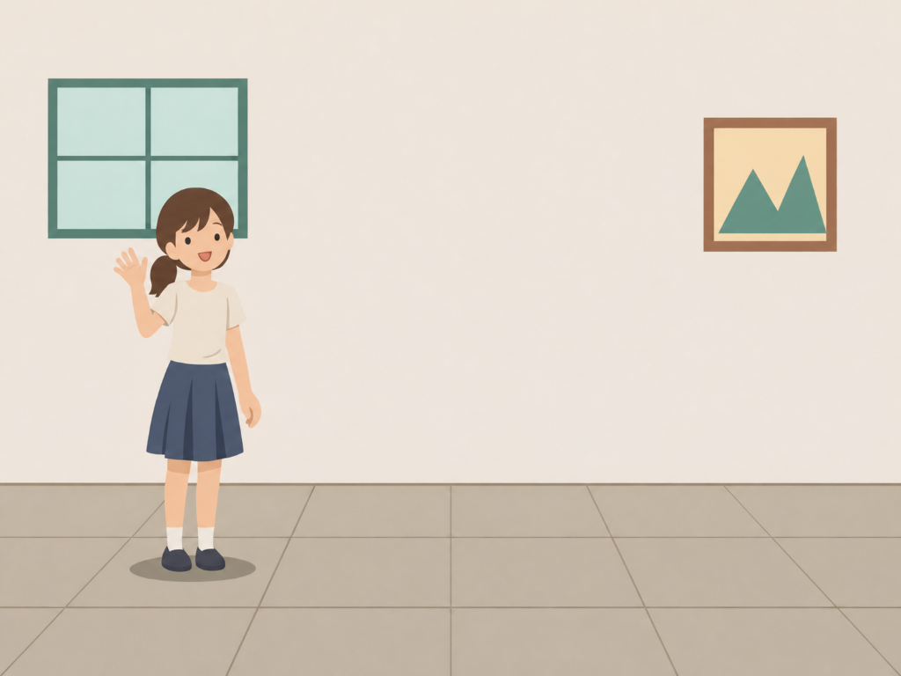 |

## Future SDK selection / 将来のSDK選択

Only the unofficial SDK edition is offered in the current public package. An installer choice for the official edition is conditional on explicit CELSYS permission for GitHub distribution and equivalent host testing; it is not a current feature. There is no runtime SDK switch in the editing screen. / 現在の公開パッケージは非公式SDK版だけです。公式版を選べるインストーラーは、CELSYSによるGitHub配布の明示許可と同等のホスト実機検証を得た後の条件付き対応で、現行機能ではありません。編集画面に実行時SDK切替はありません。


## Build from source / ソースからビルド

Use Visual Studio 2022 with Desktop development with C++, v143 and a Windows SDK. Reproduction was checked with MSVC 14.44.35207, Release x64. The default build uses the unofficial interface; no CELSYS SDK download is needed. / Visual Studio 2022のC++デスクトップ開発、v143、Windows SDKを使います。MSVC 14.44.35207のRelease x64で再現性を確認しました。既定は非公式インターフェースを使い、CELSYS SDKの取得は不要です。

```powershell
.\scripts\build-host-variants.ps1
msbuild CloudImage.vcxproj /p:Configuration=Release /p:Platform=x64 /p:Tests=true
.\build\unofficial\core_tests.exe
```

The build script also builds and runs the ABI tests. The resulting plugin is `build/unofficial/AIImageBridge.cpm`. Preserve bundled licenses and PDFs when preparing an installation package. / ビルドスクリプトはABI検査もビルドして実行します。生成プラグインは`build/unofficial/AIImageBridge.cpm`です。導入パッケージにはライセンスとPDFも保持してください。

For a reproducible offline ZIP after building, use Python 3's standard library only: / ビルド後のオフラインZIP作成には、Python 3の標準ライブラリだけを使います。

```powershell
python .\scripts\package_release.py --stage ..\release-stage --zip ..\AI-Image-Bridge-0.4.0-Windows-x64.zip
python .\scripts\verify_package.py ..\release-stage
```

Use a new or empty staging directory. The package records every file hash and uses fixed ZIP metadata. / 作業先は新規または空のフォルダーを使います。全ファイルのハッシュを記録し、ZIPのメタデータを固定します。

